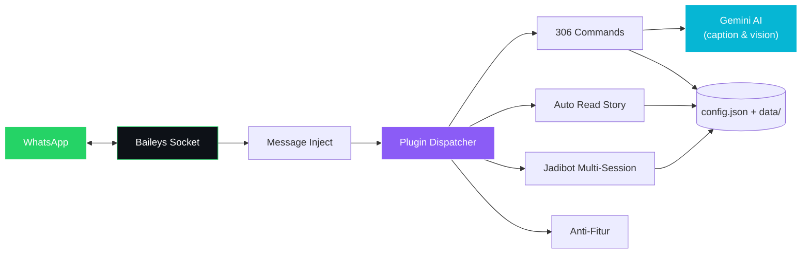

<div align="center">


### Cepat dipasang. Gampang dikembangkan. Siap untuk komunitas nyata.

<br/>


<br/>

[](https://github.com/Wilykun/ReadSwEsm_V1/stargazers)
[](https://github.com/Wilykun/ReadSwEsm_V1/network/members)


<br/>

[](https://nodejs.org/)
[](https://github.com/WhiskeySockets/Baileys)
[](#-fitur-unggulan)
[](#-update-terbaru--v275)
[](LICENSE)

<br/>

[](https://railway.com/new/template?template=https://github.com/Wilykun/ReadSwEsm_V1)
[](https://fly.io/docs/launch/)
[](#-deploy)

<br/><br/>


</div>

> **WILY BOT** adalah bot WhatsApp multi-fitur berbasis **plugin ESM** — downloader media dengan caption AI, sticker tools lengkap, otomasi grup & story, proteksi anti-fitur, sampai **Jadibot** multi-session.
>
> Dibuat untuk dipakai, dikembangkan, dan dipelajari bersama. **Gratis untuk penggunaan pribadi dan komunitas — jangan diperjualbelikan.**

<div align="center">

### ◆ Tech Stack


<br/>

### ◆ Arsitektur



<sub>166 plugin descriptor di 21 kategori folder <code>SEMUA_FITUR/</code> — semua <b>hot reload</b>: edit file plugin, bot langsung memakai versi baru tanpa restart.</sub>

</div>

---

## 📋 Daftar Isi

- [✨ Fitur Unggulan](#-fitur-unggulan)
- [🆕 Update Terbaru — V27.5](#-update-terbaru--v275)
- [📦 Instalasi](#-instalasi)
- [🚀 Deploy](#-deploy)
- [⚙️ Konfigurasi](#️-konfigurasi)
- [📖 Daftar Command Pilihan](#-daftar-command-pilihan)
- [🗂️ Struktur Proyek](#️-struktur-proyek)
- [🛡️ Stabilitas & Keamanan](#️-stabilitas--keamanan)
- [❓ FAQ](#-faq)
- [📝 Kredit](#-kredit)

---

## ✨ Fitur Unggulan

<table>
  <tr>
    <td align="center">🧠</td>
    <td><b>Caption Full AI — Gemini</b><br/><code>.fb</code> <code>.ig</code> <code>.tt</code> — video dianalisis dari <b>5 frame</b> isi videonya (bukan cuma sampul) lalu ditulis caption akurat oleh Gemini API resmi. Key cukup isi di <code>config.json</code>.</td>
  </tr>
  <tr>
    <td align="center">🎨</td>
    <td><b>Sticker AI (<code>.stickerai</code>)</b><br/>Ketik prompt → gambar AI dibuat → langsung jadi sticker die-cut bersih (tanpa teks acak/watermark), brand pack & author dari config.</td>
  </tr>
  <tr>
    <td align="center">🧩</td>
    <td><b>Stickerly Paket Native (<code>.stickerly</code>)</b><br/>Cari pack realtime, pilih dari daftar 30 pack dengan reply angka, terkirim sebagai <b>1 kartu paket utuh</b> — loading persen asli menyatu di 1 pesan, info pack realtime lengkap.</td>
  </tr>
  <tr>
    <td align="center">📱</td>
    <td><b>iPhone Quoted Chat (<code>.iqc</code>)</b><br/>Ubah teks/pesan jadi screenshot chat ala iPhone (library <code>iqc-canvas</code>) lengkap dengan bar reaksi & menu konteks iOS.</td>
  </tr>
  <tr>
    <td align="center">🗣️</td>
    <td><b>TTS 142 Bahasa (<code>.tts</code>)</b><br/>284 suara Edge TTS, picker bahasa & suara, deteksi bahasa otomatis, dan auto-translate teks ke bahasa suara tujuan via AI.</td>
  </tr>
  <tr>
    <td align="center">📥</td>
    <td><b>Multi Downloader</b><br/>TikTok (tanpa watermark), Instagram, Facebook, YouTube (<code>.play</code> / <code>.ytmp3</code> / <code>.ytmp4</code> via yt-dlp), Twitter/X, dan lainnya.</td>
  </tr>
  <tr>
    <td align="center">🎞️</td>
    <td><b>GIF Picker (<code>.animgif</code>)</b><br/>Cari GIF via Tenor dengan query bebas, pilih format GIF SD / HD / MP4, caption memuat statistik file asli.</td>
  </tr>
  <tr>
    <td align="center">🏷️</td>
    <td><b>Sticker Tools Lengkap</b><br/><code>.sticker</code> gambar/video/GIF, <code>.wm</code>/<code>.swm</code> pack & author custom (otomatis dari config bila tanpa argumen), <code>.toimg</code>, <code>.smeme</code>.</td>
  </tr>
  <tr>
    <td align="center">👁️</td>
    <td><b>Auto Read Story</b><br/>Lihat & react story kontak otomatis dengan delay acak natural 1–20 detik, plus backup story ke Telegram.</td>
  </tr>
  <tr>
    <td align="center">🤖</td>
    <td><b>Jadibot Multi-Session</b><br/>Clone bot ke nomor WhatsApp lain via pairing code — start berurutan dengan jeda agar stabil & aman dari rate-limit.</td>
  </tr>
  <tr>
    <td align="center">🛡️</td>
    <td><b>Proteksi Grup & Chat</b><br/>AntiLink, AntiTag, AntiTagSW, AntiDelete, AntiCall — semua dengan toggle per grup / global dan laporan akurat.</td>
  </tr>
  <tr>
    <td align="center">📊</td>
    <td><b>Info Realtime</b><br/><code>.cekip</code> info nomor WA (bisnis, operator, status, foto profil) • <code>.infobola klasemen</code> klasemen liga realtime • <code>.ping</code> dengan gauge skor kualitas koneksi.</td>
  </tr>
</table>

---

## 🆕 Update Terbaru — V27.5

> 📅 **Jumat, 23 Oktober 2026** — ✨ 2 Fitur Baru • 🐛 3 Fix Bug • 🚀 7 Perubahan
> 📄 Detail lengkap per item (penyebab & cara fix): [`INFORMASI_UPDATE_V27.5.txt`](./INFORMASI_UPDATE_V27.5.txt)

**✨ Fitur Baru**
1. **`.iqc` — iPhone Quoted Chat** — teks/pesan jadi screenshot ala iPhone.
2. **`.stickerai` — Sticker dari Prompt AI** — gambar AI (flux) langsung jadi sticker bersih.

**🐛 Fix Bug Pilihan**
- **`.stickerly` paket blank & kadang kekirim satuan** — upload memakai kunci khusus sticker-pack (`/mms/sticker-pack`) + retry 3x anti putus koneksi; satuan hanya jaring pengaman terakhir.
- **AntiTag** — mention massal ditangani akurat tanpa salah hapus pesan admin.

**🚀 Perubahan Pilihan**
- **`.fb` / `.ig` / `.tt` caption full AI** — Gemini API resmi dari `config.json` + analisis 5 frame video.
- **`.stickerly`** — loading persen asli menyatu di 1 pesan, penjaga anti dobel, pesan daftar pilihan berubah jadi loading, pesan sukses info realtime penuh.
- **`.tts`** — 5 suara → 142 bahasa / 284 suara + auto-translate.
- **`.ping`** — gauge skor kualitas koneksi A+ s/d D.

---

## 📦 Instalasi

**Persyaratan:** Node.js **20+**, npm, **ffmpeg**, koneksi internet.

```bash
# 1. Clone repo
git clone https://github.com/Wilykun/ReadSwEsm_V1.git
cd ReadSwEsm_V1

# 2. Install dependensi
npm install

# 3. Atur config.json (lihat bagian Konfigurasi)

# 4. Jalankan bot
node index.js
```

Saat pertama jalan, masukkan nomor WhatsApp bot untuk menerima **Pairing Code**, lalu di HP:

> **WhatsApp → Perangkat Tertaut → Tautkan Perangkat → Tautkan dengan Nomor Telepon → masukkan kode**

Untuk panel **Pterodactyl**, cukup pakai startup bawaan repo:

```bash
bash start-ptero.sh   # atau: npm start
```

---

## 🚀 Deploy

File deploy sudah tersedia di repo — tinggal pakai:

| Platform | File | Catatan |
|---|---|---|
| **Railway** | `railway.toml` + `Dockerfile` | Pasang **Volume** untuk `/app/sessions`, `/app/data`, `/app/jadibot` agar sesi tidak hilang saat restart |
| **Fly.io** | `fly.toml` + `Dockerfile` | Buat volume per mount di `fly.toml`; region `sin` paling dekat ke Indonesia |
| **Pterodactyl** | `start-ptero.sh` | Startup resmi bot di panel (dipakai juga oleh `npm start`) |
| **Docker** | `Dockerfile` | Node.js 20 + ffmpeg sudah termasuk di image |

> ⚠️ Di semua platform: folder **`sessions/`** dan **`data/`** wajib persistent. Tanpa volume, setiap restart = pairing ulang dari awal.

---

## ⚙️ Konfigurasi

Semua pengaturan terpusat di **`config.json`** — dibaca ulang oleh fitur yang membutuhkannya, jadi sebagian perubahan langsung berlaku tanpa restart.

```json
{
  "owners": ["6281234567890"],
  "geminiApiKey": "",
  "sticker": {
    "pack": "Nama Pack",
    "author": "Nama Author"
  },
  "autoReadStory": {
    "enabled": true,
    "autoReaction": true,
    "randomDelay": true,
    "delayMinMs": 1000,
    "delayMaxMs": 20000
  }
}
```

| Key | Fungsi |
|---|---|
| `owners` | Nomor owner bot (format `628xxx`, tanpa `+`) |
| `geminiApiKey` | API key Google Gemini (dari [AI Studio](https://aistudio.google.com/apikey)) — mengaktifkan caption & vision AI di `.fb` / `.ig` / `.tt`. Kosong = fitur jalan dengan jalur cadangan |
| `sticker.pack` / `sticker.author` | Brand pack & author untuk semua sticker (`.sticker`, `.wm`, `.stickerai`, `.stickerly`) |
| `autoReadStory` | Auto lihat & react story + rentang delay acaknya |
| `autoOnline`, `antiDelete`, `antiCall`, `telegram`, `autoSimi` | Toggle & pengaturan fitur latar — detailnya langsung di `config.json` |

---

## 📖 Daftar Command Pilihan

Daftar lengkap **306 command** selalu tersedia di dalam bot lewat `.menu`. Ini cuplikan per kategori:

<details>
<summary><b>🔽 Sticker & Media</b></summary>

| Command | Fungsi |
|---|---|
| `.stickerai <prompt>` | Buat sticker dari prompt AI |
| `.s` / `.sticker` | Buat sticker dari gambar/video/GIF |
| `.wm` / `.swm` | Sticker dengan pack & author custom |
| `.stickerly <keyword/link>` | Cari & kirim pack Stickerly sebagai 1 paket |
| `.stickerpack <keyword>` | Sama, langsung mode paket |
| `.toimg` | Sticker → gambar |
| `.iqc <teks>` | Screenshot chat ala iPhone |

</details>

<details>
<summary><b>🔽 Downloader</b></summary>

| Command | Fungsi |
|---|---|
| `.tt <link>` | TikTok tanpa watermark — caption AI |
| `.ig <link>` | Foto/video/reel Instagram — caption AI |
| `.fb <link>` | Video/reel/story Facebook — caption AI |
| `.play <judul>` | Cari & unduh audio YouTube |
| `.ytmp3` / `.ytmp4 <link>` | Unduh YouTube via URL |
| `.animgif <query>` | Cari GIF di Tenor |

</details>

<details>
<summary><b>🔽 AI & Suara</b></summary>

| Command | Fungsi |
|---|---|
| `.tts <teks>` | Text-to-speech 142 bahasa / 284 suara |
| `.gemini <tanya>` | Chat AI Gemini |
| `.simi on/off` | Auto-reply AI di chat |

</details>

<details>
<summary><b>🔽 Info & Tools</b></summary>

| Command | Fungsi |
|---|---|
| `.ping` | Kecepatan bot + gauge skor kualitas |
| `.cekip <nomor>` | Info nomor WhatsApp realtime |
| `.infobola klasemen` | Klasemen liga realtime |
| `.readsw` / `.ceksw` | Baca & cek story WhatsApp |
| `.rvo` / `.rvo2` | Buka media view-once |

</details>

<details>
<summary><b>🔽 Grup & Proteksi</b></summary>

| Command | Fungsi |
|---|---|
| `.antilink on/off` | Hapus pesan berisi link |
| `.antitag on/off` | Tangani mention massal |
| `.antidel on/off` | Kirim ulang pesan yang dihapus |
| `.anticall on/off` | Tolak panggilan otomatis |
| `.hidetag` / `.ghosttag` | Mention semua member (tersembunyi) |

</details>

---

## 🗂️ Struktur Proyek

```
ReadSwEsm_V1/
├─ index.js               # Entry point bot
├─ message.js             # Dispatcher pesan → plugin
├─ config.json            # Semua konfigurasi (+ geminiApiKey)
├─ SEMUA_FITUR/           # 166 plugin ESM dalam 21 kategori
│  ├─ ai/        anime/      download/   group/
│  ├─ jadibot/   maker/      media/      menu/
│  ├─ music/     readsw/     system/     tools/  …
├─ src/helper/            # Loader plugin, hot reload, AI prompt, auth state
├─ sessions/              # Sesi WhatsApp (single-file auth state)
├─ data/                  # Data runtime (statistik, tracking, cache)
├─ scripts/               # check-plugins.js + snapshot 306 command
├─ Dockerfile · fly.toml · railway.toml · start-ptero.sh
└─ INFORMASI_UPDATE_V27.5.txt
```

Sistem plugin: setiap command adalah file ESM mandiri dengan metadata (`command`, `tags`, `help`). Tambah fitur = tambah 1 file + daftarkan di hot reload — **tanpa mengutak-atik dispatcher**. Validasi konsistensi plugin & snapshot command:

```bash
node scripts/check-plugins.js                # cek
node scripts/check-plugins.js --update-snapshot
```

---

## 🛡️ Stabilitas & Keamanan

- **Crash Guard** — error di handler tidak menjatuhkan bot; proses berat di-skip otomatis bila melewati batas waktu.
- **Hot Reload** — plugin & helper diperbarui live; file bermasalah tidak memutus proses utama.
- **Memory Monitor** — pemakaian RAM dipantau berkala dengan log ringkas.
- **Auto Cleaner** — file temp hasil download dibersihkan berkala.
- **Single-File Session** — sesi WhatsApp dalam satu file auth state (`sessions/hisoka.json`), gampang dibackup & dipindah.

---

## ❓ FAQ

<details>
<summary><b>Pairing code tidak muncul?</b></summary>

Pastikan nomor bot benar (format `628xxx`), belum melewati batas 4 perangkat tertaut, dan koneksi stabil. Hapus sesi lama bila korup: matikan bot → hapus isi `sessions/` → jalankan lagi.
</details>

<details>
<summary><b>Sesi hilang setiap restart?</b></summary>

Itu tanda storage tidak persistent — pasang Volume untuk `sessions/` dan `data/` (Railway/Fly.io) atau pastikan folder tidak terhapus di panel/VPS kamu.
</details>

<details>
<summary><b>Caption .fb/.ig/.tt tidak full AI?</b></summary>

Isi `geminiApiKey` di `config.json` dengan key dari [Google AI Studio](https://aistudio.google.com/apikey) (gratis). Tanpa key, bot memakai jalur cadangan dan caption hanya berbasis metadata.
</details>

<details>
<summary><b>Command tidak dikenali?</b></summary>

Cek prefix (default `.`) dan ejaan lewat `.menu`. Untuk command khusus owner, pastikan nomormu ada di `owners` pada `config.json`.
</details>

<details>
<summary><b>Bot disconnect / reconnect terus?</b></summary>

Biasanya koneksi server tidak stabil atau perangkat tertaut melebihi batas. Bot reconnect otomatis tanpa menghapus sesi; cek log untuk kode disconnect bila berulang.
</details>

---


## 📝 Kredit

<div align="center">

<table>
  <tr>
    <td align="center" width="220">
      <b>Bang Wily</b> <sub>(Wilykun)</sub><br/>
      Pengembang & Recode
    </td>
    <td align="center" width="220">
      <b>Bang Dika Ardnt</b><br/>
      Base Script Original
    </td>
    <td align="center" width="220">
      <b>WhiskeySockets</b><br/>
      <a href="https://github.com/WhiskeySockets/Baileys">Baileys</a> (WhatsApp Web API)
    </td>
  </tr>
</table>

<sub>Library & layanan lain: <b>yt-dlp</b> (YouTube) • <b>Google Gemini</b> (AI caption & vision) • <b>Pollinations</b> (gambar AI .stickerai) • <b>Stickerly</b> (sumber pack) • <b>Tenor</b> (GIF) • <b>iqc-canvas</b> (.iqc) • <b>sharp</b> & <b>wa-sticker-formatter</b> (sticker)</sub>

<br/><br/>

> ⚠️ **Script ini GRATIS dan tidak untuk diperjualbelikan.**
> Kalau kamu menemukannya dijual, itu penipuan — laporkan ke owner.

<br/>

[](https://wa.me/6289681008411)
&nbsp;
[](https://t.me/Wilykun1994)
&nbsp;
[](https://github.com/Wilykun/ReadSwEsm_V1)

<br/>


</div>


